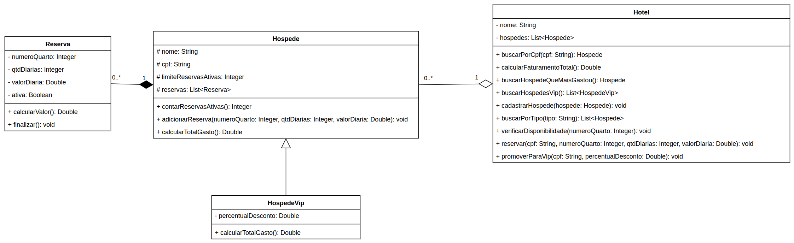

# 🏨 Avaliação Continuada 02 - Gerenciamento de Hotel 📎

## Orientações Gerais: 🚨

1. Utilize **apenas** tipos **wrapper** para criar atributos e métodos.
2. **Respeite** os nomes de atributos, classes, pacotes e métodos definidos no exercício.
3. Tome **cuidado** com os **argumentos** especificados no exercício. **Não** adicione argumentos
   não solicitados e mantenha a ordem definida no enunciado.
4. Verifique se **não** há **erros de compilação** no projeto antes de enviar.
5. As classes devem seguir as regras de encapsulamento.
6. No final deste enunciado há alguns [snippets de código](#-snippets-de-código) para ajudar na
   implementação. Utilize-os para facilitar a implementação dos métodos.

---

## Sistema de Reservas

Olá, desenvolvedor,

Você foi contratado para desenvolver o sistema de reservas de um hotel.

O hotel possui um cadastro de **hóspedes**, e cada hóspede possui as suas **reservas**. Uma reserva
só existe enquanto o hóspede existir e é sempre **criada pelo próprio hóspede**, ou seja, a relação
entre `Hospede` e `Reserva` é uma **composição**.

Para fidelizar os clientes, o hotel possui o programa **Hóspede Vip**, que oferece um percentual de
desconto sobre todas as reservas e permite manter mais reservas ativas ao mesmo tempo.

Situações inválidas devem ser comunicadas através de **exceptions**.

A vantagem é que o sistema já possui um diagrama pré-definido, o que facilita a implementação das
regras de negócio. Os construtores, getters e setters não estão no diagrama; eles estão descritos no
enunciado de cada classe.

Boa Sorte 🍀

Segue o diagrama com as regras a serem implementadas:



> Dica: Para facilitar a implementação, siga a ordem das classes do enunciado, começando pelas
exceptions, depois `Reserva`, `Hospede`, `HospedeVip` e por fim `Hotel`.

---

## ⚠️ Exceptions (pacote `school.sptech.exceptions`)

Configure as exceptions conforme a tabela abaixo:

| Exception                         | Tipo          |
|-----------------------------------|---------------|
| `DadoInvalidoException`           | **unchecked** |
| `HospedeNaoEncontradoException`   | **unchecked** |
| `LimiteReservasExcedidoException` | **unchecked** |
| `QuartoIndisponivelException`     | **checked**   |

---

### 🛏️ Classe `Reserva` (pacote `school.sptech.hospede`)

* Deve conter apenas getters para todos os atributos.

#### Construtor:

* `Reserva(Integer numeroQuarto, Integer qtdDiarias, Double valorDiaria)`

    * Deve lançar `DadoInvalidoException` caso `numeroQuarto` seja nulo ou menor/igual a zero.
    * Deve lançar `DadoInvalidoException` caso `qtdDiarias` seja nula ou menor/igual a zero.
    * Deve lançar `DadoInvalidoException` caso `valorDiaria` seja nulo ou menor/igual a zero.
    * Inicia os atributos `numeroQuarto`, `qtdDiarias` e `valorDiaria`.
    * Inicia a reserva como ativa (`ativa` igual a `true`).

---

#### Métodos:

* `Double calcularValor()`

    * Calcula o valor total da reserva seguindo as regras abaixo, **nesta ordem**:
        1. O valor da reserva é o total de diárias vezes o valor da diária.
        2. Reservas com **mais de 5 diárias** recebem **20% de desconto** sobre o valor.
        3. Por fim, é somada uma **taxa de limpeza de R$ 40,00**. Reservas com **mais de 10
           diárias** são **isentas** da taxa de limpeza.

---

* `void finalizar()`

    * Marca a reserva como não ativa (`ativa` igual a `false`).

---

### 🧍 Classe `Hospede` (pacote `school.sptech.hospede`)

* Deve conter getters para todos os atributos e setters para `nome`, `cpf` e
  `limiteReservasAtivas`. O atributo `reservas` **não** deve possuir setter.

#### Construtor:

* `Hospede(String nome, String cpf)`

    * Deve lançar `DadoInvalidoException` caso `nome` seja nulo ou vazio.
    * Deve lançar `DadoInvalidoException` caso `cpf` seja nulo ou vazio.
    * Inicia os atributos `nome` e `cpf`.
    * Inicia o atributo `limiteReservasAtivas` com **3**. Ele representa a quantidade máxima de
      reservas **ativas** que o hóspede pode ter ao mesmo tempo.
    * Inicia a lista de reservas vazia.

---

#### Métodos:

* `Integer contarReservasAtivas()`

    * Retorna a quantidade de reservas **ativas** do hóspede.

---

* `void adicionarReserva(Integer numeroQuarto, Integer qtdDiarias, Double valorDiaria)`

    * Deve lançar `LimiteReservasExcedidoException` caso a quantidade de reservas ativas já seja
      igual ao limite do hóspede (`limiteReservasAtivas`).
    * Cria uma `Reserva` com os dados informados e adiciona na lista de reservas.
    * Dados inválidos devem resultar em `DadoInvalidoException` (lançada pelo construtor de
      `Reserva`).
    * Em caso de exceção, nenhuma reserva deve ser adicionada.

---

* `Double calcularTotalGasto()`

    * Retorna a soma do valor de **todas** as reservas do hóspede, ativas e finalizadas.
    * Caso não possua reservas, retorna `0.0`.

---

### ⭐ Classe `HospedeVip` (pacote `school.sptech.hospede`)

* Deve herdar de `Hospede`.
* Deve conter apenas getters para todos os atributos.

#### Construtor:

* `HospedeVip(String nome, String cpf, Double percentualDesconto)`

    * Deve lançar `DadoInvalidoException` caso `percentualDesconto` seja nulo, menor que **0** ou
      maior que **50**.
    * Inicia o atributo `percentualDesconto`.
    * Hóspedes Vip possuem limite de **10** reservas ativas, ou seja, o construtor deve alterar o
      `limiteReservasAtivas` para `10`.
    * Deve aplicar as mesmas validações e inicializações de `Hospede`.

---

#### Métodos:

* `Double calcularTotalGasto()`

    * Deve **sobrescrever** o método de `Hospede`.
    * Retorna o total gasto do hóspede com o percentual de desconto aplicado.
    * O percentual de desconto não está representado em decimal, ou seja, `10%` é representado como
      `10.0`.
    * Exemplo: total de `100.0` com `10%` de desconto resulta em `90.0`.

---

### 🏨 Classe `Hotel` (pacote `school.sptech`)

* Deve conter apenas getters para todos os atributos.

#### Construtor:

* `Hotel(String nome)`

    * Deve lançar `DadoInvalidoException` caso `nome` seja nulo ou vazio.
    * Inicia o atributo `nome`.
    * Inicia a lista de hóspedes vazia.

---

#### Métodos:

* `Hospede buscarPorCpf(String cpf)`

    * Retorna o hóspede correspondente.
    * Caso não encontre, deve lançar `HospedeNaoEncontradoException`.

---

* `Double calcularFaturamentoTotal()`

    * Retorna a soma do total gasto de **todos** os hóspedes do hotel (respeitando o desconto dos
      hóspedes Vip).
    * Caso não existam hóspedes, retorna `0.0`.

---

* `Hospede buscarHospedeQueMaisGastou()`

    * Retorna o hóspede com o maior total gasto (respeitando o desconto dos hóspedes Vip).
    * Caso não existam hóspedes, retorna `null`.

---

* `List<HospedeVip> buscarHospedesVip()`

    * Retorna apenas os hóspedes Vip.
    * Caso não exista nenhum, retorna lista vazia.

---

* `void cadastrarHospede(Hospede hospede)`

    * Verifique se o `cpf` do novo hóspede já existe na lista de hóspedes do hotel.
    * Caso já exista um hóspede com o mesmo `cpf`, não faça nada (não deve lançar exception).
        * Dica: lembre-se da estrutura para tratar **exceções**.
    * Caso não exista, adiciona o hóspede na lista.

---

* `List<Hospede> buscarPorTipo(String tipo)`

    * Retorna os hóspedes pelo tipo.
    * Caso `tipo` seja `"vip"`, retorna apenas os hóspedes Vip.
    * Caso `tipo` seja `"classico"`, retorna apenas os hóspedes que **não** são Vip.
    * A comparação deve ignorar maiúsculas e minúsculas (`"VIP"`, `"Classico"`, etc.).
    * Para qualquer outro valor de `tipo`, retorna lista vazia.
    * Caso não exista nenhum, retorna lista vazia.

---

* `void verificarDisponibilidade(Integer numeroQuarto)`

    * Verifica se o quarto informado está disponível para reserva.
    * Você deve ver todas as reservas **ativas** de todos os hóspedes do hotel.
    * Caso o quarto esteja ocupado, deve lançar `QuartoIndisponivelException`.
    * Reservas já finalizadas **não** ocupam o quarto, ou seja, apenas reservas ativas devem ser
      consideradas.
    * Caso o quarto esteja livre, não faz nada.
    * Deve lançar `DadoInvalidoException` caso `numeroQuarto` seja nulo ou menor/igual a zero.

---

* `void reservar(String cpf, Integer numeroQuarto, Integer qtdDiarias, Double valorDiaria)`

    * Busca o hóspede pelo `cpf`. Caso não exista, deve lançar `HospedeNaoEncontradoException`.
    * Verifica a disponibilidade do quarto. Caso o quarto esteja indisponível, **não** deve lançar
      `QuartoIndisponivelException`, mas sim exibir uma mensagem informando que o quarto está
      ocupado, e a reserva **não** deve ser realizada.
    * Caso o quarto esteja disponível, adiciona a reserva no hóspede.

---

* `void promoverParaVip(String cpf, Double percentualDesconto)`

    * Busca o hóspede pelo `cpf`. Caso não exista, deve lançar `HospedeNaoEncontradoException`.
    * A promoção **não deve ocorrer** em uma dessas condições:
        * **Já** seja Vip;
        * Possua **menos de 3 reservas**;
        * Possua um total gasto **menor ou igual que 70% da média de total gasto dos hóspedes
          clássicos** (não Vip) do hotel, incluindo o próprio hóspede nessa média.
    * Caso alguma dessas condições seja atendida, não faça nada.
    * Caso o hóspede seja elegível para promoção:
        * Remove o hóspede clássico;
        * Cria um novo `HospedeVip` com o mesmo `nome`, `cpf` e o `percentualDesconto` informado;
        * Transfere **todas as reservas** do hóspede antigo para o novo hóspede, preservando seus
          dados e seu estado (ativa ou finalizada);
        * Adiciona o novo hóspede Vip à lista de hóspedes do hotel.

---

## 💡 Snippets de código

Os trechos abaixo podem ser utilizados para facilitar a implementação.

### Iterar uma lista com for tradicional

```java
for (int i = 0; i < filmes.size(); i++) {
    Filme filme = filmes.get(i);
    System.out.println(filme);
}
```

### Iterar uma lista com enhanced for

```java
for (Filme filme : filmes) {
    System.out.println(filme);
}
```

### Validar `" "` ou `""` com o método `isBlank()`

```java
if (nome.isBlank()) {
    System.out.println("Está vazio");
} else {
    System.out.println("Não está vazio");
}
```

### "Casting" de objetos dentro de uma lista

```java
List<Animal> animais = new ArrayList<>();
animais.add(new Cachorro("Caramelo"));
animais.add(new Gato("Marrom"));

Animal animal = animais.get(0);

if (animal instanceof Cachorro) {
    Cachorro cachorro = (Cachorro) animal;
    cachorro.latir();
}

// Casting com pattern variable
if (animal instanceof Cachorro cachorro) {
    cachorro.latir();
}
```

### Criar uma exception **unchecked**

```java
public class SaldoInvalidoException extends RuntimeException {

    public SaldoInvalidoException(String message) {
        super(message);
    }
}
```

### Criar uma exception **checked** 

```java
public class ContaBloqueadaException extends Exception {

    public ContaBloqueadaException(String message) {
        super(message);
    }
}
```

### Lançar uma exception

```java
if (saldo < 0) {
    throw new SaldoInvalidoException("Saldo não pode ser negativo");
}
```
