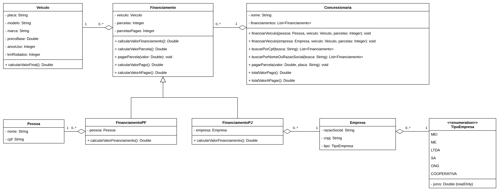

# Exercício - Concessionária 🚦🚗 🚙 🚕

## Orientações Gerais 🚨

1. Utilize **apenas** tipos **wrapper** para criar atributos e métodos.
2. **Respeite** os nomes de atributos, classes, pacotes e métodos definidos no exercício.
3. Tome **cuidado** com os **argumentos** especificados no exercício.
4. **Não adicione** argumentos não solicitados e mantenha a ordem definida no enunciado.
5. Verifique se **não há erros de compilação** no projeto antes de enviar.
6. As classes devem seguir as regras de **encapsulamento**.
7. Situações inválidas devem ser comunicadas através de **exceptions**.

## Diagrama de classes

---

## Exceptions (pacote `school.sptech.exceptions`)

Crie as exceptions conforme a tabela abaixo.

| Exception                                    | Tipo          |
|----------------------------------------------|---------------|
| `PagamentoInvalidoException`                 | **unchecked** |
| `RequisicaoDeFinanciamentoInvalidaException` | **unchecked** |
| `DocumentoInvalidoException`                 | **unchecked** |
| `ValorInexistenteException`                  | **unchecked** |

---

## Classe `Veiculo` 🚙

**Getters e Setters**
- Deve conter **todos** os métodos getters e setters para todos os atributos.

**Construtor**
- `Veiculo(String placa, String modelo, String marca, Double precoBase, Integer anosUso, Integer kmRodados)`

### Métodos

**`calcularValorFinal`**
- Retorna o valor do veículo (`Double`) seguindo as regras abaixo:
    1. Para cada **ano de uso**, reduz **1% do preço base**.
    2. Para cada **10.000 km completos** rodados, reduz **R$ 500,00** (ex.: 25.000 km = 2 × 500).
    3. Caso a marca seja `"Ferrari"`, `"Lamborghini"` ou `"Porsche"` (ignorando maiúsculas e
       minúsculas), **acrescenta 10% do preço base**.

| Marca     | Preço base       | Anos de uso | Km rodados | Cálculo                                  | Valor final      |
|-----------|------------------|-------------|------------|------------------------------------------|------------------|
| Chevrolet | R$ 80.000,00     | 3           | 25.000     | 80.000 − 2.400 − 1.000                   | R$ 76.600,00     |
| Ferrari   | R$ 1.500.000,00  | 2           | 15.000     | 1.500.000 + 150.000 − 30.000 − 500       | R$ 1.619.500,00  |

---

## Classe `Pessoa` 🙋

**Getters e Setters**
- Deve conter **todos** os métodos getters e setters para todos os atributos.

**Construtor**
- `Pessoa(String nome, String cpf)`

---

## Classe `Empresa` 🏭

**Getters e Setters**
- Deve conter **todos** os métodos getters e setters para todos os atributos.

**Construtor**
- `Empresa(String razaoSocial, String cnpj, TipoEmpresa tipo)`

---

## Enum `TipoEmpresa` 📚

- O atributo `juros` deve possuir **apenas getter**.
- Os juros são representados em **decimal**, ou seja, `3%` é representado como `0.03`.

| Constante     | Juros  |
|---------------|--------|
| `MEI`         | `0.03` |
| `ME`          | `0.05` |
| `LTDA`        | `0.10` |
| `SA`          | `0.15` |
| `ONG`         | `0.0`  |
| `COOPERATIVA` | `0.01` |

---

## Classe abstrata `Financiamento` 🤑

**Getters e Setters**
- Deve conter **todos** os métodos getters e setters para todos os atributos.

**Construtor**
- `Financiamento(Veiculo veiculo, Integer parcelas)`
    - Inicia os atributos `veiculo` e `parcelas`.
    - Inicia `parcelasPagas` com `0`.

### Métodos

**`calcularValorFinanciamento`**
- Método **abstrato** que retorna o valor total do financiamento (`Double`).

**`calcularValorParcela`**
- Retorna o valor de cada parcela do financiamento.

**`pagarParcela`**
- Recebe o valor pago (`Double`). Não retorna nada (`void`).
- Valida, **nesta ordem**:
    1. Caso o valor seja `null` ou **diferente** do valor da parcela, lança
       `PagamentoInvalidoException`.
    2. Caso o financiamento já esteja quitado, lança `PagamentoInvalidoException`.
- Caso esteja tudo certo, aumenta em 1 a quantidade de parcelas pagas.

**`calcularValorPago`**
- Retorna o valor pago até o momento.

**`calcularValorAPagar`**
- Retorna o valor que ainda falta pagar.

---

## Classe `FinanciamentoPF` 💵

**Getters e Setters**
- Deve conter **todos** os métodos getters e setters para todos os atributos.

**Construtor**
- `FinanciamentoPF(Veiculo veiculo, Integer parcelas, Pessoa pessoa)`

### Métodos

**`calcularValorFinanciamento`**
- Retorna o valor final do veículo com **20% de juros**.

---

## Classe `FinanciamentoPJ` 💶

**Getters e Setters**
- Deve conter **todos** os métodos getters e setters para todos os atributos.

**Construtor**
- `FinanciamentoPJ(Veiculo veiculo, Integer parcelas, Empresa empresa)`

### Métodos

**`calcularValorFinanciamento`**
- Retorna o valor final do veículo acrescido dos **juros do tipo da empresa**.

---

## Classe `Concessionaria` 🏪

**Getters**
- Deve conter **apenas** getters para todos os atributos.

**Construtor**
- `Concessionaria(String nome)`
    - Inicia o atributo `nome`.
    - Inicia a lista de financiamentos **vazia**.

### Métodos

**`financiarVeiculo` (pessoa física)**
- `financiarVeiculo(Pessoa pessoa, Veiculo veiculo, Integer parcelas)`. Não retorna nada (`void`).
- Valida, **nesta ordem**:
    1. Caso `pessoa`, `veiculo` ou `parcelas` sejam `null`, lança `ValorInexistenteException`.
    2. Caso `parcelas` seja menor ou igual a `0` ou maior que `600`, lança
       `RequisicaoDeFinanciamentoInvalidaException`.
    3. Caso o CPF seja `null` ou **não** tenha **exatamente 11 caracteres**, lança `DocumentoInvalidoException`.
- Caso esteja tudo certo, cria um `FinanciamentoPF` e adiciona na lista de financiamentos.

**`financiarVeiculo` (pessoa jurídica)**
- `financiarVeiculo(Empresa empresa, Veiculo veiculo, Integer parcelas)`. Não retorna nada (`void`).
- Valida, **nesta ordem**:
    1. Caso `empresa`, `veiculo` ou `parcelas` sejam `null`, lança `ValorInexistenteException`.
    2. Caso `parcelas` seja menor ou igual a `0` ou maior que `600`, lança
       `RequisicaoDeFinanciamentoInvalidaException`.
    3. Caso o CNPJ seja `null` ou **não** tenha **exatamente 14 caracteres**, lança `DocumentoInvalidoException`.
- Caso esteja tudo certo, cria um `FinanciamentoPJ` e adiciona na lista de financiamentos.

| Documento          | Válido? | Motivo                         |
|--------------------|---------|--------------------------------|
| `"12345678901"`    | ✅      | CPF com 11 caracteres          |
| `"1234567890"`     | ❌      | CPF com só 10 caracteres       |
| `"123.456.789-01"` | ❌      | CPF com 14 caracteres          |
| `"12345678000199"` | ✅      | CNPJ com 14 caracteres         |
| `"1234567800019"`  | ❌      | CNPJ com só 13 caracteres      |

**`buscarPorCpf`**
- Recebe o CPF buscado (`String`). Retorna `List<Financiamento>`.
- Retorna os financiamentos de **pessoa física** cujo CPF é **igual** ao buscado.
- Caso não encontre, retorna lista vazia.

**`buscarPorNomeOuRazaoSocial`**
- Recebe o texto buscado (`String`). Retorna `List<Financiamento>`.
- Retorna os financiamentos cujo **nome da pessoa** ou **razão social da empresa** **contém** o texto
  buscado, ignorando maiúsculas e minúsculas.
    - Exemplo: a busca `"silva"` encontra `"Ana Silva"` e `"Silva & Filhos LTDA"`.
- Caso não encontre, retorna lista vazia.

**`pagarParcela`**
- `pagarParcela(Double valor, String placa)`. Não retorna nada (`void`).
- Caso `valor` ou `placa` sejam `null`, lança `ValorInexistenteException`.
- Busca o financiamento do veículo com a placa informada e chama o `pagarParcela` **desse**
  financiamento. Apenas esse financiamento deve ser alterado.
- Caso não exista financiamento com a placa, lança `ValorInexistenteException`.

**`totalValorPago`**
- Retorna a soma do valor pago de **todos** os financiamentos.
- Caso não existam financiamentos, retorna `0.0`.

**`totalValorAPagar`**
- Retorna a soma do valor a pagar de **todos** os financiamentos.
- Caso não existam financiamentos, retorna `0.0`.
