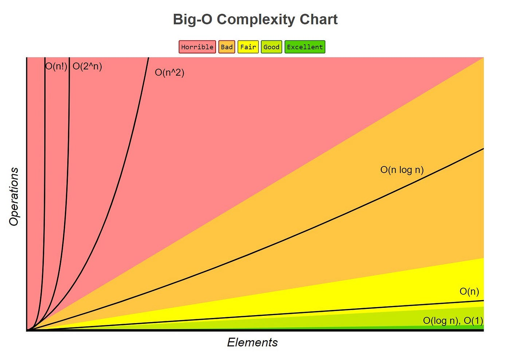

# Exercício - Algoritmos de Ordenação 📎

## Orientações Gerais: 🚨

1. Utilize **apenas** tipos **wrapper** para criar variáveis.
2. Verifique se **não** há **erros de compilação** no projeto antes de enviar.

---

Neste exercício, você vai analisar, entender e implementar os algoritmos clássicos de ordenação em
Java: **Selection Sort**, **Selection Sort Otimizado**, **Bubble Sort** e **Insertion Sort**.

Ordenar os dados é uma tarefa fundamental em programação e ciência da computação, pois facilita:

* 🔍 **Busca** (procurar elementos rapidamente)
* 📊 **Processamento** e análise de dados
* 🧩 **Comparação e organização** de informações

Ordenar números de menor para maior ou palavras em ordem alfabética são tarefas comuns
que podem ser resolvidas por algoritmos de ordenação.

Cada algoritmo deste exercício será apresentado com:

1. Uma **breve explicação**;
2. Um **pseudo-código** (uma forma de representar um algoritmo usando uma linguagem semi-informal,
   próxima da linguagem humana, mas estruturada o suficiente para mostrar claramente os passos que o
   computador deve executar);
3. **Exemplos de entrada e saída**

---

## 🟢 Exercício 1 - Selection Sort

**Descrição:**
O Selection Sort percorre o array procurando o menor elemento e o coloca na posição correta,
repetindo o processo para todas as posições do array.

**Pseudo-código:**

```
selectionSort(int[] v)
início
    inteiro i, j;
    para i de 0 enqto i < v.length-1 faça
    início
        para j de i+1 enqto j < v.length faça
        início
            se v[j] < v[i]
            então troca(v[i], v[j]);
        fim
    fim
fim
```

**Exemplo:**

| Entrada              | Saída                |
|----------------------|----------------------|
| [64, 25, 12, 22, 11] | [11, 12, 22, 25, 64] |

---

## ⚡ Exercício 2 - Selection Sort Otimizado

**Descrição:**
Versão otimizada do Selection Sort. Em vez de trocar sempre que encontra um elemento menor, ele
memoriza o índice do menor e faz apenas uma troca no final de cada iteração.

**Pseudo-código:**

```
selectionSortOtimizado(int[] v)
início
    inteiro i, j, indMenor;
    para i de 0 enqto i < v.length-1 faça
    início
        indMenor <- i;
        para j de i+1 enqto j < v.length faça
        início
            se v[j] < v[indMenor]
            então indMenor <- j;
        fim
        troca(v[i], v[indMenor]);
    fim
fim
```

**Exemplo:**

| Entrada              | Saída                |
|----------------------|----------------------|
| [29, 10, 14, 37, 13] | [10, 13, 14, 29, 37] |

---

## 🫧 Exercício 3 - Bubble Sort

**Descrição:**
O Bubble Sort compara elementos adjacentes e troca-os se estiverem na ordem errada. Este processo se
repete até que o array esteja ordenado.

**Pseudo-código:**

```
bubbleSort(int[] v)
início
    inteiro i, j;
    para i de 0 enquanto i < v.length-1 faça
    início
        para j de 1 enquanto j < v.length-i faça
        início
            se v[j-1] > v[j] 
            então troca(v[j], v[j-1]);
        fim
    fim
fim
```

**Exemplo:**

| Entrada         | Saída           |
|-----------------|-----------------|
| [5, 1, 4, 2, 8] | [1, 2, 4, 5, 8] |

---

## 🏗️ Exercício 04 - Insertion Sort

**Descrição:**
O Insertion Sort constrói a lista ordenada um elemento de cada vez, inserindo cada elemento na
posição correta em relação aos anteriores.

**Pseudo-código:**

```
insertionSort(int[] v)
início
    inteiro i, j, x;
    para i de 1 enquanto i < v.length faça
    início
        x <- v[i];
        j <- i - 1;
        enquanto (j >= 0) e (v[j] > x) faça
        início
            v[j+1] <- v[j];
            j <- j - 1;
        fim
        v[j+1] <- x;
    fim
fim
```

**Exemplo:**

| Entrada            | Saída              |
|--------------------|--------------------|
| [12, 11, 13, 5, 6] | [5, 6, 11, 12, 13] |

---

## 💡 Dica:

Para trocar, é preciso 3 instruções (é necessário uma
variável auxiliar):

- aux = v[i];
- v[i] = v[j];
- v[j] = aux

## 🤓 Mais: Notação Big O

A **Notação Big O** é utilizada para **avaliar a eficiência de um algoritmo**, tanto em **tempo de
execução** quanto em **uso de memória**, à medida que o **tamanho da entrada** (`n`) aumenta.

Ela descreve como o desempenho de um algoritmo escala com o crescimento dos dados, independentemente
do computador, da linguagem de programação ou de detalhes de implementação.
Em outras palavras, a Big O mede **a taxa de crescimento do número de operações**, e não o tempo
real gasto.

---

### 🧠 Intuição

Imagine que você precise ordenar uma lista de números:

* Com 10 elementos, o algoritmo pode ser rápido.
* Mas, com 1.000.000 de elementos, o tempo pode aumentar **muito mais rapidamente**, dependendo
  do tipo de algoritmo usado.

A notação Big O nos ajuda a prever como esse tempo de execução cresce à medida que a entrada
aumenta.

Normalmente, analisamos o **pior caso**, ou seja, o cenário em que o algoritmo realiza o maior
número possível de operações.
Isso garante uma avaliação segura e consistente do desempenho, sem depender de circunstâncias
específicas dos dados de entrada.




### ⚙️ Escala de complexidade

| Notação        | Nome                   | Exemplo prático                                              | Explicação                                                                                            | Tempo de Execução                 |
|----------------|------------------------|--------------------------------------------------------------|-------------------------------------------------------------------------------------------------------|-----------------------------------|
| **O(1)**       | Tempo **constante**    | Acessar o primeiro elemento de uma lista                     | O tempo **não depende** do tamanho da entrada, sempre executa a mesma quantidade de operações.        | Sempre rápido ⚡                   |
| **O(log n)**   | Tempo **logarítmico**  | Busca binária em uma lista ordenada                          | A cada passo, o algoritmo **descarta metade** dos elementos, tornando-o muito eficiente.              | Reduz pela metade a cada passo ✂️ |
| **O(n)**       | Tempo **linear**       | Percorrer todos os elementos de uma lista com um `for`       | O tempo **cresce proporcionalmente** ao tamanho da entrada. Se dobrar `n`, o tempo dobra.             | Cresce junto com a lista 📈       |
| **O(n log n)** | Tempo **quase linear** | Algoritmos como **Merge Sort** e **Quick Sort**              | Combina uma parte linear e uma parte logarítmica, comum em ordenações eficientes.                     | Um meio-termo eficiente ⚙️        |
| **O(n²)**      | Tempo **quadrático**   | Dois loops aninhados (`for` dentro de `for`)                 | O tempo cresce **muito mais rápido**, pois cada elemento é comparado com todos os outros.             | Fica pesado muito rápido 🐢       |
| **O(2ⁿ)**      | Tempo **exponencial**  | Algoritmos recursivos sem otimização (ex: Fibonacci)         | O número de operações **dobra a cada novo elemento**, tornando o crescimento extremamente rápido.     | Cresce de forma explosiva 🚀      |
| **O(n!)**      | Tempo **fatorial**     | Geração de **todas as permutações possíveis** de um conjunto | O algoritmo precisa **testar todas as combinações**, e o tempo cresce de forma desproporcional a `n`. | Extremamente custoso 💣           |

---

### 🔍 Complexidade dos algoritmos estudados

| Algoritmo             | BigO  |
|-----------------------|-------|
| 🧩 **Selection Sort** | O(n²) | 
| 💨 **Bubble Sort**    | O(n²) | 
| 🎯 **Insertion Sort** | O(n²) | 

## 💡 Veja mais:

[Visualização e comparação dos Algoritmos de Ordenação -
Viktor Bohush](https://www.youtube.com/watch?v=ZZuD6iUe3Pc)


