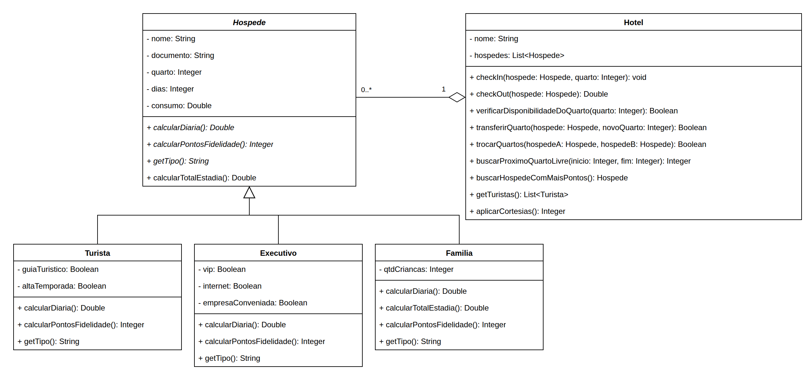

# Exercício - Hotelaria

## Orientações Gerais 🚨

1. Utilize **apenas** tipos **wrapper** para criar atributos e métodos.
2. **Respeite** os nomes de atributos e métodos definidos no exercício.
3. Tome **cuidado** com os **argumentos** especificados no exercício.
4. **Não adicione** argumentos não solicitados e mantenha a ordem definida no enunciado.
5. Verifique se **não há erros de compilação** no projeto antes de enviar.
6. As classes devem seguir as regras de **encapsulamento**.
7. Situações inválidas devem ser comunicadas através de **exceptions**.

## Diagrama de classes

> Dica: siga a ordem do enunciado. Comece pelas exceptions, depois `Hospede`, as três subclasses e,
> por último, o `Hotel`. Vários métodos do `Hotel` dependem dos cálculos das subclasses.

---

## Exceptions (pacote `school.sptech.exceptions`)

Crie as exceptions conforme a tabela abaixo. Todas devem ter um construtor que recebe a mensagem
(`String`) e a repassa para a superclasse.

| Exception                     | Tipo          |
|-------------------------------|---------------|
| `ValorInvalidoException`      | **unchecked** |
| `QuartoInvalidoException`     | **unchecked** |
| `HospedeForaDoHotelException` | **unchecked** |
| `QuartoOcupadoException`      | **checked**   |

---

## Classe `Hospede`

**Getters e Setters**
- Deve conter **todos** os métodos getters e setters para todos os atributos.
- `setDias` deve lançar `ValorInvalidoException` caso `dias` seja `null` ou menor ou igual a zero.
- `setConsumo` deve lançar `ValorInvalidoException` caso `consumo` seja `null` ou negativo
  (consumo zero é permitido).
- Quando lançar a exception, o valor anterior do atributo **não** pode ser alterado.

**Construtor**
- `Hospede(String nome, String documento, Integer quarto, Integer dias, Double consumo)`
- Deve aplicar as **mesmas validações** dos setters. Dica: reaproveite os setters em vez de repetir
  os `if`.

### Métodos

**`calcularDiaria`**
- Método **abstrato** que calcula o valor da diária do hóspede.

**`calcularPontosFidelidade`**
- Método **abstrato** que retorna a quantidade de pontos de fidelidade (`Integer`) que o hóspede
  ganha com a estadia.

**`getTipo`**
- Método **abstrato** que retorna o tipo do hóspede (`String`).

**`calcularTotalEstadia`**
- Calcula o total da estadia seguindo as regras abaixo, **nesta ordem**:
    1. **Hospedagem:** os **7 primeiros dias** são cobrados pelo valor cheio da diária. Os dias
       **a partir do 8º** são cobrados com **15% de desconto** na diária.
    2. **Consumo:** sobre o consumo é cobrada uma **taxa de serviço de 10%**.
    3. O total é a soma da hospedagem com o consumo (já com a taxa).

| Dias | Diária      | Consumo   | Hospedagem                     | Consumo com taxa | Total       |
|------|-------------|-----------|--------------------------------|------------------|-------------|
| 3    | R\$ 2.500,00 | R\$ 450,00 | 3 × 2.500 = 7.500,00           | 495,00           | R\$ 7.995,00 |
| 10   | R\$ 1.000,00 | R\$ 50,00  | 7 × 1.000 + 3 × 850 = 9.550,00 | 55,00            | R\$ 9.605,00 |

---

## Classe `Turista`

**Getters e Setters**
- Deve conter **todos** os métodos getters e setters para todos os atributos.

**Construtor**
- `Turista(String nome, String documento, Integer quarto, Integer dias, Double consumo, Boolean guiaTuristico, Boolean altaTemporada)`

### Métodos

**`calcularDiaria`**
- O valor base da diária é de R\$ 1.500,00.
- Em **alta temporada**, a diária base tem um acréscimo de **30%**.
- Caso o turista opte pelo **guia turístico**, a diária é acrescida de **R\$ 500,00**.
- ⚠️ O acréscimo da alta temporada vale **apenas** sobre a diária base, **não** sobre o guia.
    - Exemplo: alta temporada com guia: `1500 × 1,30 + 500 = R$ 2.450,00`.

**`calcularPontosFidelidade`**
- O turista ganha **1 ponto a cada R\$ 100,00 completos** do total da estadia.
    - Exemplo: total de R\$ 6.330,00 = **63 pontos** (os R\$ 30,00 restantes não geram ponto).

**`getTipo`**
- Retorna `"Turista"`.

---

## Classe `Executivo`

**Getters e Setters**
- Deve conter **todos** os métodos getters e setters para todos os atributos.

**Construtor**
- `Executivo(String nome, String documento, Integer quarto, Integer dias, Double consumo, Boolean vip, Boolean internet, Boolean empresaConveniada)`

### Métodos

**`calcularDiaria`**
- Calcula a diária seguindo as regras abaixo, **nesta ordem**:
    1. O valor base da diária é de R\$ 2.000,00.
    2. Caso tenha acesso à **área VIP**, a diária é acrescida de R\$ 1.000,00.
    3. Caso tenha **internet de alta velocidade**, a diária é acrescida de R\$ 500,00. Porém, para
       quem **também** tem acesso VIP, a internet custa apenas **R\$ 250,00**.
    4. Caso o executivo seja de uma **empresa conveniada**, recebe **10% de desconto** sobre a
       diária já com todos os adicionais.
- Exemplo: VIP, com internet e de empresa conveniada: `(2000 + 1000 + 250) × 0,90 = R$ 2.925,00`.

**`calcularPontosFidelidade`**
- O executivo ganha **2 pontos a cada R\$ 100,00 completos** do total da estadia.
- Executivos com acesso **VIP** ganham o **dobro** de pontos.
    - Exemplo: total de R\$ 6.610,00 com VIP: `66 × 2 = 132`, em dobro = **264 pontos**.

**`getTipo`**
- Retorna `"Executivo"`.

---

## Classe `Familia`

**Getters e Setters**
- Deve conter **todos** os métodos getters e setters para todos os atributos.

**Construtor**
- `Familia(String nome, String documento, Integer quarto, Integer dias, Double consumo, Integer qtdCriancas)`

### Métodos

**`calcularDiaria`**
- O valor base da diária é de R\$ 1.200,00.
- As **2 primeiras crianças não pagam**. A **3ª e a 4ª** criança acrescentam **R\$ 150,00 cada**.
  Da 5ª criança em diante, não há cobrança.
- Caso `qtdCriancas` seja `null` ou negativo, considere **0** crianças.

| Crianças  | Diária      |
|-----------|-------------|
| 0, 1 ou 2 | R\$ 1.200,00 |
| 3         | R\$ 1.350,00 |
| 4 ou mais | R\$ 1.500,00 |

**`calcularTotalEstadia`**
- Deve **sobrescrever** o método de `Hospede`.
- Reaproveite o cálculo de `Hospede` (sem copiar o código) e, caso a estadia seja de **mais de 5
  dias**, aplique **5% de desconto** sobre o total.
    - Exemplo: 6 dias, 4 crianças, sem consumo: `6 × 1.500 = 9.000,00`, com desconto = **R\$ 8.550,00**.

**`calcularPontosFidelidade`**
- A família ganha **1 ponto a cada R\$ 200,00 completos** do total da estadia, mais **5 pontos por
  criança** (todas as crianças contam, seguindo a mesma regra do `null`/negativo da diária).
    - Exemplo: total de R\$ 8.550,00 com 4 crianças: `42 + 20` = **62 pontos**.

**`getTipo`**
- Retorna `"Familia"`.

---

## Classe `Hotel`

**Getters**
- Deve conter **apenas** getters para todos os atributos.

**Construtor**
- `Hotel(String nome)`
    - Inicia o atributo `nome`.
    - Inicia a lista de hóspedes **vazia**.

### Métodos

**`checkIn`**
- Recebe um `Hospede` e o número do quarto. Não retorna nada (`void`).
- Deve lançar `ValorInvalidoException` caso o hóspede seja `null`.
- Caso o hóspede **já esteja** hospedado no hotel, não faz nada (não deve lançar exception nem
  trocar o quarto dele).
- Deve lançar `QuartoInvalidoException` caso o quarto seja `null` ou menor ou igual a zero.
- Deve lançar `QuartoOcupadoException` caso o quarto já esteja ocupado. Como ela é **checked**, o
  método precisa declarar `throws QuartoOcupadoException`.
- Caso contrário, atualiza o quarto do hóspede (usando o setter) e adiciona o hóspede no fim da
  lista.

**`checkOut`**
- Recebe o hóspede que realizará o check-out. Retorna `Double`.
- Deve lançar `HospedeForaDoHotelException` caso o hóspede não esteja no hotel (inclusive se for
  `null`).
- Caso esteja, remove o hóspede da lista, seta o quarto dele como `null` e **retorna o total da
  estadia** do hóspede.

**`verificarDisponibilidadeDoQuarto`**
- Recebe o número do quarto. Retorna `Boolean`.
- Deve lançar `QuartoInvalidoException` caso o quarto seja `null` ou menor ou igual a zero.
- Retorna `true` se nenhum hóspede estiver no quarto, e `false` caso contrário.

**`transferirQuarto`**
- Recebe o hóspede e o número do novo quarto. Retorna `Boolean`.
- Deve lançar `HospedeForaDoHotelException` caso o hóspede não esteja no hotel.
- Deve lançar `QuartoInvalidoException` caso o novo quarto seja `null` ou menor ou igual a zero.
- Caso o novo quarto esteja ocupado (inclusive pelo próprio hóspede), **não** lança exception:
  apenas retorna `false` e não altera nada.
- Caso contrário, atualiza o quarto do hóspede e retorna `true`.

**`trocarQuartos`**
- Recebe dois hóspedes. Retorna `Boolean`.
- Troca os quartos entre os dois: quem estava no quarto do primeiro passa para o do segundo, e
  vice-versa.
- Deve lançar `HospedeForaDoHotelException` caso algum dos dois não esteja no hotel. Essa
  validação vem **antes** de qualquer outra.
- Caso os dois sejam o **mesmo** hóspede, retorna `false` e não altera nada.

**`buscarProximoQuartoLivre`**
- Recebe o quarto de `inicio` e o quarto de `fim` de um intervalo. Retorna `Integer`.
- Retorna o **primeiro** quarto livre do intervalo, incluindo o `inicio` e o `fim`.
- Deve lançar `QuartoInvalidoException` caso `inicio` ou `fim` sejam `null`, ou caso `inicio` seja
  menor ou igual a zero.
- Deve lançar `ValorInvalidoException` caso `inicio` seja maior que `fim`.
- Caso todos os quartos do intervalo estejam ocupados, retorna `null`.

**`buscarHospedeComMaisPontos`**
- Retorna o hóspede com **mais pontos de fidelidade**.
- Em caso de empate nos pontos, retorna o que tiver o **maior total da estadia**.
- Se ainda assim houver empate, retorna o que aparece **primeiro** na lista.
- Caso não existam hóspedes, retorna `null`.

**`getTuristas`**
- Retorna uma lista com todos os turistas que estão atualmente hospedados no hotel, na mesma ordem
  da lista de hóspedes.
- Caso não existam turistas, retorna lista vazia.

**`aplicarCortesias`**
- Percorre os hóspedes do hotel e aplica uma cortesia de acordo com o tipo de cada um. Retorna
  `Integer`.
    - **Turista** em **alta temporada** que **não** tem guia turístico ganha o guia turístico.
    - **Executivo** de **empresa conveniada** que **não** tem internet ganha a internet.
    - **Família** não recebe cortesia.
- Retorna a quantidade de hóspedes que receberam cortesia. Quem já possuía o benefício **não**
  conta.
- Caso não existam hóspedes, retorna `0`.
