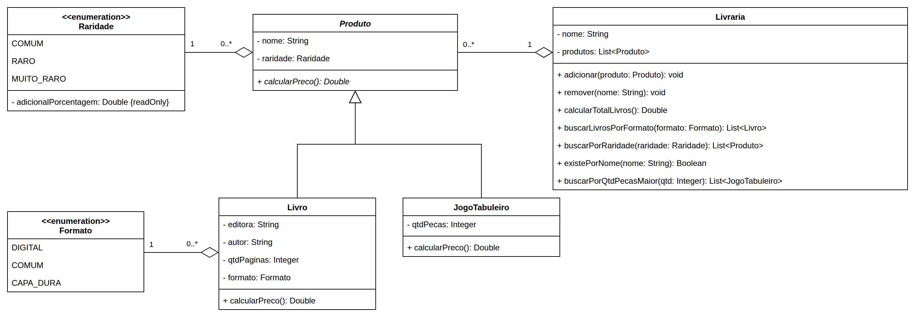

# Exercício - Livraria 📚

## Orientações Gerais 🚨

1. Utilize **apenas** tipos **wrapper** para criar atributos e métodos.
2. **Respeite** os nomes de atributos, classes, pacotes e métodos definidos no exercício.
3. Tome **cuidado** com os **argumentos** especificados no exercício.
4. **Não adicione** argumentos não solicitados e mantenha a ordem definida no enunciado.
5. Verifique se **não há erros de compilação** no projeto antes de enviar.
6. As classes devem seguir as regras de **encapsulamento**.

## Diagrama de classes

---

## Enum `Formato`

Deve possuir as constantes abaixo (sem atributos):

- `DIGITAL`
- `COMUM`
- `CAPA_DURA`

---

## Enum `Raridade`

- O atributo `adicionalPorcentagem` deve possuir **apenas getter**.
- O adicional **não** está representado em decimal, ou seja, `10%` é representado como `10.0`.

| Constante    | `adicionalPorcentagem` |
|--------------|------------------------|
| `COMUM`      | `0.0`                  |
| `RARO`       | `10.0`                 |
| `MUITO_RARO` | `20.0`                 |

---

## Classe `Produto`

**Getters e Setters**
- Deve conter **todos** os métodos getters e setters para todos os atributos.

**Construtor**
- `Produto(String nome, Raridade raridade)`

### Métodos

**`calcularPreco`**
- Método **abstrato** que retorna o preço do produto (`Double`).

---

## Classe `Livro`

**Getters e Setters**
- Deve conter **todos** os métodos getters e setters para todos os atributos.

**Construtor**
- `Livro(String nome, Raridade raridade, String editora, String autor, Integer qtdPaginas, Formato formato)`

### Métodos

**`calcularPreco`**
- O preço base é a quantidade de páginas multiplicada pelo valor por página do formato:

| Formato     | Valor por página |
|-------------|------------------|
| `DIGITAL`   | R$ 0,20          |
| `COMUM`     | R$ 0,30          |
| `CAPA_DURA` | R$ 0,40          |

- Considere também o adicional de **raridade** do produto.

| Livro          | Páginas | Formato   | Raridade     | Preço     |
|----------------|---------|-----------|--------------|-----------|
| O Silmarillion | 500     | `COMUM`   | `COMUM`      | R$ 150,00 |
| O Hobbit       | 300     | `COMUM`   | `MUITO_RARO` | R$ 108,00 |
| Origem         | 400     | `DIGITAL` | `RARO`       | R$ 88,00  |

---

## Classe `JogoTabuleiro`

**Getters e Setters**
- Deve conter **todos** os métodos getters e setters para todos os atributos.

**Construtor**
- `JogoTabuleiro(String nome, Raridade raridade, Integer qtdPecas)`

### Métodos

**`calcularPreco`**
- O preço base é a quantidade de peças multiplicada por **R$ 0,50**.
- Considere também o adicional de **raridade** do produto.
    - Exemplo: `Jogo da Vida`, 60 peças, `RARO` = **R$ 33,00**.

---

## Classe `Livraria`

**Getters**
- Deve conter **apenas** getters para todos os atributos.

**Construtor**
- `Livraria(String nome)`
    - Inicia o atributo `nome`.
    - Inicia a lista de produtos **vazia**.

### Métodos

**`adicionar`**
- Recebe um `Produto`. Não retorna nada (`void`).
- Adiciona o produto no **fim** da lista de produtos.

**`remover`**
- Recebe o nome do produto (`String`). Não retorna nada (`void`).
- Remove da lista o produto com o nome **igual** ao informado.
- Caso não exista produto com esse nome, não faz nada.

**`calcularTotalLivros`**
- Retorna a soma do preço (`calcularPreco`) de **todos os livros** da livraria (`Double`).
- Jogos de tabuleiro **não** entram na soma.
- Caso não existam livros, retorna `0.0`.

**`buscarLivrosPorFormato`**
- Recebe um `Formato`. Retorna `List<Livro>`.
- Retorna os livros do formato informado, na mesma ordem da lista de produtos.
- Caso não encontre, retorna lista vazia.

**`buscarPorRaridade`**
- Recebe uma `Raridade`. Retorna `List<Produto>`.
- Retorna **todos os produtos** (livros e jogos) da raridade informada, na mesma ordem da lista.
- Caso não encontre, retorna lista vazia.

**`existePorNome`**
- Recebe o nome do produto (`String`). Retorna `Boolean`.
- Retorna `true` caso exista um produto com o nome **igual** ao informado, e `false` caso contrário.

**`buscarPorQtdPecasMaior`**
- Recebe uma quantidade de peças (`Integer`). Retorna `List<JogoTabuleiro>`.
- Retorna os jogos de tabuleiro com quantidade de peças **maior** (e não igual) que a informada, na
  mesma ordem da lista.
- Caso não encontre, retorna lista vazia.
