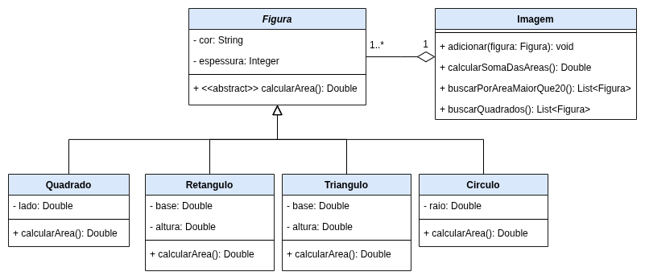

# Exercício - Classe Abstrata 📎

## Orientações Gerais: 🚨

1. Utilize **apenas** tipos **wrapper** para criar atributos e métodos.
2. **Respeite** os nomes de atributos e métodos definidos no exercício.
3. Tome **cuidado** com os **argumentos** especificados no exercício:
5. **Não** adicione argumentos não solicitados e mantenha a ordem definida no enunciado.
6. Verifique se **não** há **erros de compilação** no projeto antes de enviar.
7. As classes devem seguir as regras de encapsulamento.

---

## Diagrama de Classes

---

### 🌟 Classe Abstrata: `Figura`

A classe `Figura` representa uma forma geométrica com um método abstrato para cálculo da área.

#### Métodos:

- **`public abstract Double calcularArea()`**
    - **Descrição**: Método abstrato que deve ser implementado nas classes filhas para calcular a área da figura.

- **`@Override public String toString()`**
    - **Descrição**: Retorna uma representação textual do objeto `Figura` com suas informações.

**Observações**:
- Deve possuir os métodos getters e setters para os atributos.
---

### 🟦 Classe: `Quadrado`

A classe `Quadrado` representa um quadrado e implementa o cálculo da área.

#### Métodos Públicos:

- **`@Override public Double calcularArea()`**
    - **Descrição**: Retorna a área do quadrado calculada ao multiplicar o lado por ele mesmo.

- **`@Override public String toString()`**
    - **Descrição**: Retorna uma representação textual do objeto `Quadrado`.

**Observações**:
- Deve possuir os métodos getters e setters para os atributos.
---

### █ Classe: `Retangulo`

A classe `Retangulo` representa um retângulo e implementa o cálculo da área.

#### Métodos Públicos:

- **`@Override public Double calcularArea()`**
    - **Descrição**: Retorna a área do retângulo ao multiplicar a base pela altura.

- **`@Override public String toString()`**
    - **Descrição**: Retorna uma representação textual do objeto `Retangulo`.

**Observações**:
- Deve possuir os métodos getters e setters para os atributos.
---

### 🔺 Classe: `Triangulo`

A classe `Triangulo` representa um triângulo e implementa o cálculo da área.

#### Métodos Públicos:

- **`@Override public Double calcularArea()`**
    - **Descrição**: Retorna a área do triângulo calculada ao multiplicar a base pela altura e dividir por 2.

- **`@Override public String toString()`**
    - **Descrição**: Retorna uma representação textual do objeto `Triangulo`.

**Observações**:
- Deve possuir os métodos getters e setters para os atributos.
---

### ⚪ Classe: `Circulo`

A classe `Circulo` representa um círculo e implementa o cálculo da área.

#### Métodos Públicos:

- **`@Override public Double calcularArea()`**
    - **Descrição**: Retorna a área do círculo calculada ao multiplicar o raio ao quadrado por `π`.
    - **Nota**: Utilize `Math.PI` para obter o valor de `π`.

- **`@Override public String toString()`**
    - **Descrição**: Retorna uma representação textual do objeto `Circulo`.

**Observações**:
- Deve possuir os métodos getters e setters para os atributos.
---

### 🖼️ Classe: `Imagem`

A classe `Imagem` representa uma composição de figuras geométricas.

#### Métodos Públicos:

- **`public void adicionar(Figura figura)`**
    - **Descrição**: Adiciona uma figura à lista de figuras da imagem.

- **`public Double calcularSomaDasAreas()`**
    - **Descrição**: Retorna a soma das áreas de todas as figuras na imagem.

- **`public List<Figura> buscarPorAreaMaiorQue20()`**
    - **Descrição**: Retorna uma lista das figuras cuja área é maior que 20.

- **`public List<Figura> buscarQuadrados()`**
    - **Descrição**: Retorna uma lista com as figuras que são quadrados.
    - **Nota**: Utilize o método `instanceof` para verificar se a figura é um quadrado.
