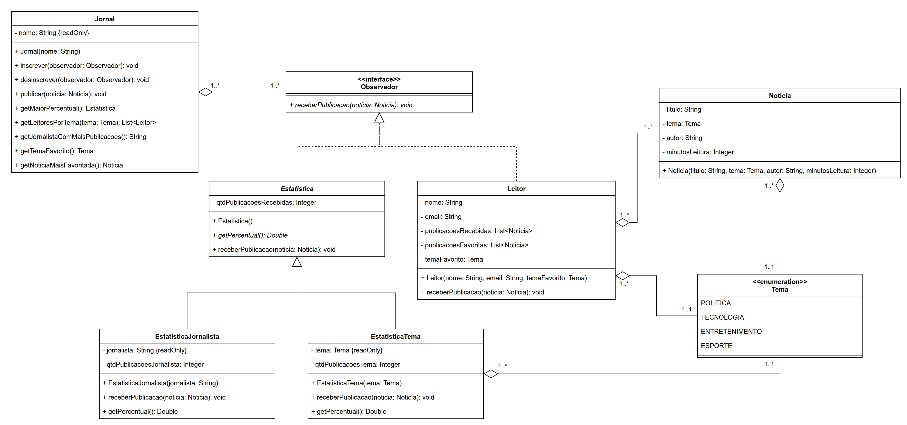

# Exercício - Jornal Digital 📰

## Orientações Gerais: 🚨
1. Utilize **apenas** tipos **wrapper** para criar atributos e métodos.
2. **Respeite** os nomes de atributos e métodos definidos no exercício.
3. Tome **cuidado** com os **argumentos** especificados no exercício.
   **Não** adicione argumentos não solicitados e mantenha a ordem definida no enunciado.
4. Verifique se **não** há **erros de compilação** no projeto antes de enviar.
5. As classes devem seguir as regras de encapsulamento.

### Exercício - Jornal Digital

Implemente o seguinte diagrama de classes:

### Observer

> "O Observer é um padrão de projeto comportamental que permite que você defina um mecanismo de assinatura para notificar múltiplos objetos sobre quaisquer eventos que aconteçam com o objeto que eles estão observando."
>
> -- Refactoring Guru

Saiba mais: \
https://refactoring.guru/pt-br/design-patterns/observer

### Classe `Noticia`

#### Construtor:

Deve possuir um construtor cheio e validar as seguintes condições:
- O título não pode ser nulo ou vazio.
- O tema não pode ser nulo.
- O autor não pode ser nulo ou vazio.
- Os minutos de leitura não podem ser nulos e devem ser maiores que zero.

Caso alguma dessas condições não sejam atendidas, deve ser lançada uma exceção do tipo `NoticiaInvalidaException`.

* Deve conter apenas getters para todos os atributos.

### Classe `NoticiaInvalidaException`

* Deve ser uma exceção **unchecked**, ou seja, deve herdar de `RuntimeException`.

### Interface `Observador`

#### Método:

* `void receberPublicacao(Noticia noticia)`
  * Método abstrato que será chamado para notificar o observador sobre uma nova publicação.

### Classe `Leitor`

#### Construtor:

* `Leitor(String nome, String email, Tema temaFavorito)`
  * Inicializa os atributos `nome`, `email` e `temaFavorito`.
  * Inicializa a lista `publicacoesRecebidas` como uma lista vazia.
  * Inicializa a lista `publicacoesFavoritas` como uma lista vazia.

#### Métodos:

* `receberPublicacao(Noticia noticia)`
  * Adiciona a notícia recebida à lista `publicacoesRecebidas` do leitor.
  * Se o tema da notícia for igual ao tema favorito do leitor, a notícia também deve ser adicionada à lista de publicações favoritas.

* Deve conter apenas getters para todos os atributos.

### Classe `Estatistica`

#### Construtor:

* `Estatistica()`
  * Inicializa o atributo `qtdPublicacoesRecebidas` com zero.

#### Métodos:

* `getPercentual()`
  * Método abstrato que retorna o percentual (de 0 a 100) da estatística em relação ao total de notícias recebidas.

* `receberPublicacao(Noticia noticia)`
  * Incrementa o atributo `qtdPublicacoesRecebidas`.

* Deve conter apenas getters para todos os atributos.

### Classe `EstatisticaTema`

#### Construtor:

* `EstatisticaTema(Tema tema)`
  * Inicializa o atributo `tema`.
  * Inicializa o atributo `qtdPublicacoesTema` com zero.

#### Métodos:

* `receberPublicacao(Noticia noticia)`
  * Atualiza o total de publicações recebidas.
  * Se o tema da notícia for igual ao tema da estatística, incrementa o atributo `qtdPublicacoesTema`.

* `getPercentual()`
  * Retorna o percentual de notícias do tema em relação ao total de notícias recebidas.
  * Se `qtdPublicacoesRecebidas` for zero, o método deve retornar `0.0` para evitar divisão por zero.

* Deve conter apenas getters para todos os atributos.

### Classe `EstatisticaJornalista`

#### Construtor:

* `EstatisticaJornalista(String jornalista)`
  * Inicializa o atributo `jornalista`.
  * Inicializa o atributo `qtdPublicacoesJornalista` com zero.

#### Métodos:

* `receberPublicacao(Noticia noticia)`
  * Atualiza o total de publicações recebidas.
  * Se o autor da notícia for igual ao jornalista da estatística, incrementa o atributo `qtdPublicacoesJornalista`.

* `getPercentual()`
  * Retorna o percentual de notícias do jornalista em relação ao total de notícias recebidas.
  * Se `qtdPublicacoesRecebidas` for zero, o método deve retornar `0.0` para evitar divisão por zero.

* Deve conter apenas getters para todos os atributos.

### Classe `Jornal`

#### Construtor:

* `Jornal(String nome)`
  * Inicializa o atributo `nome`.
  * Inicializa a lista `observadores` como uma lista vazia.

#### Métodos:

* `inscrever(Observador observador)`
  * Adiciona o observador ao final da lista de observadores.

* `desinscrever(Observador observador)`
  * Remove o observador da lista de observadores.

* `publicar(Noticia noticia)`
  * Notifica todos os observadores sobre a nova notícia, chamando o método `receberPublicacao` de cada observador com a notícia como argumento.

* `getMaiorPercentual()`
  * Retorna a estatística com o maior percentual entre todas as estatísticas inscritas no jornal.
  * Se não houver estatísticas inscritas, o método deve retornar `null`.

* `getLeitoresPorTema(Tema tema)`
  * Retorna uma lista com os leitores inscritos cujo tema favorito é igual ao tema fornecido como argumento, na ordem em que foram inscritos.
  * Retorna uma lista vazia se nenhum leitor corresponder ao tema.

* `getJornalistaComMaisPublicacoes()`
  * Retorna o nome do jornalista com o maior número de publicações (`qtdPublicacoesJornalista`) entre as estatísticas de jornalista inscritas.
  * Se não houver estatísticas de jornalista inscritas no jornal, o método deve retornar `null`.

* `getTemaFavorito()` (Desafio 🔥)
  * Retorna o tema que mais aparece como tema favorito entre os leitores inscritos no jornal.
  * Se não houver leitores inscritos no jornal, o método deve retornar `null`.

* `getNoticiaMaisFavoritada()` (Desafio 🔥)
  * Retorna a notícia que aparece na lista `publicacoesFavoritas` do maior número de leitores inscritos no jornal.
  * Se não houver leitores inscritos, ou se nenhum leitor tiver notícias favoritas, o método deve retornar `null`.

* Deve conter apenas getters para todos os atributos.
