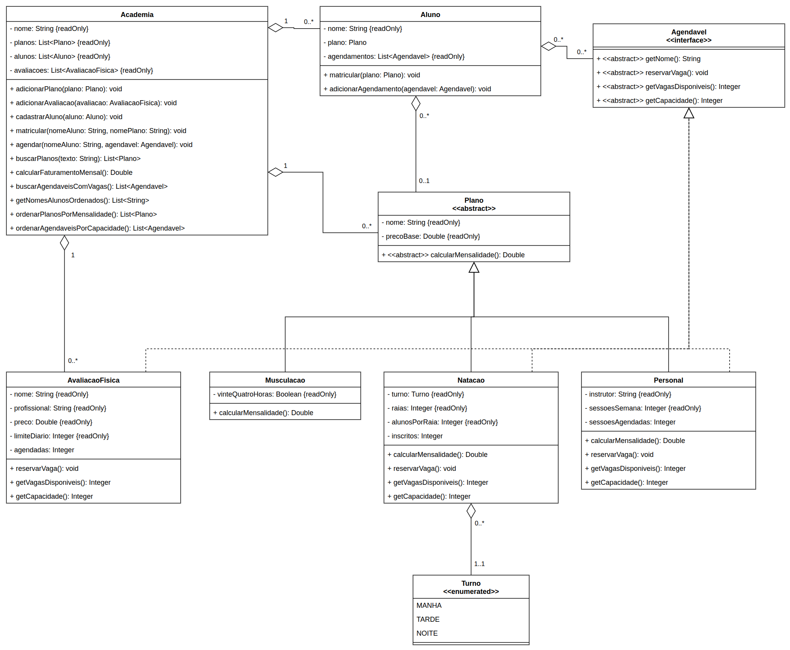

# Exercício - Academia 🏋️

## Orientações Gerais: 🚨
1. Utilize **apenas** tipos **wrapper** para criar atributos e métodos.
2. **Respeite** os nomes de atributos, classes, pacotes e métodos definidos no exercício.
3. Tome **cuidado** com os **argumentos** especificados no exercício.
   **Não** adicione argumentos não solicitados e mantenha a ordem definida no enunciado.
4. Verifique se **não** há **erros de compilação** no projeto antes de enviar.
5. As classes devem seguir as regras de encapsulamento.
6. Situações inválidas devem ser comunicadas através de **exceptions**.
7. Os métodos de ordenação devem ser implementados **manualmente** (com algum dos algoritmos vistos em aula).
   **Não** utilize `Collections.sort`, `List.sort`, `Comparator` ou `stream().sorted()`.
8. Os métodos de ordenação **não** podem alterar a ordem das listas originais.

---

# Case: Academia SPTech Fit 💪

Você foi contratado para desenvolver o sistema de uma academia.

O sistema deve permitir:

* cadastro de planos, avaliações físicas e alunos
* matrícula dos alunos
* agendamento de aulas e avaliações que possuem vagas limitadas
* cálculo do faturamento mensal
* relatórios e rankings ordenados

Aqui está a especificação das classes do sistema:

---

# Exceptions (pacote `school.sptech.exception`)

Crie as exceptions conforme a tabela abaixo.

| Exception                   | Tipo          | Quando é lançada                                                  |
|-----------------------------|---------------|-------------------------------------------------------------------|
| `DadoInvalidoException`     | **unchecked** | Dados inválidos, duplicados ou operação não permitida             |
| `NaoEncontradoException`    | **unchecked** | Aluno ou plano não encontrado na academia                         |
| `VagaIndisponivelException` | **unchecked** | Tentativa de reservar uma vaga quando não há vagas disponíveis    |

---

# Enum `Turno`

Crie um enum chamado `Turno` com os seguintes valores:

* MANHA
* TARDE
* NOITE

---

# Interface `Agendavel`

Define um contrato para tudo o que pode ser agendado e possui vagas limitadas.

## Métodos

* `String getNome()`
    * Método abstrato que retorna o nome do agendável.

* `void reservarVaga()`
    * Método abstrato responsável por ocupar uma vaga.

* `Integer getVagasDisponiveis()`
    * Método abstrato que retorna a quantidade de vagas ainda disponíveis.

* `Integer getCapacidade()`
    * Método abstrato que retorna a quantidade **total** de vagas (ocupadas + disponíveis).

---

# Classe `Plano`

## Construtor

* `Plano(String nome, Double precoBase)`
    * Inicializa os atributos `nome` e `precoBase`.
    * Caso o `nome` seja nulo, vazio ou em branco, deve lançar `DadoInvalidoException`.
    * Caso o `precoBase` seja nulo ou negativo, deve lançar `DadoInvalidoException`.

## Métodos

* `Double calcularMensalidade()`
    * Método abstrato responsável por retornar o valor da mensalidade do plano.

* Deve conter apenas getters para todos os atributos.

---

# Classe `Musculacao`

## Construtor

* `Musculacao(String nome, Double precoBase, Boolean vinteQuatroHoras)`
    * Inicializa os atributos `nome`, `precoBase` e `vinteQuatroHoras`.

## Métodos

* `Double calcularMensalidade()`
    * Planos com acesso **24 horas** possuem acréscimo de **20%** no preço base.
    * Caso contrário, mantém o preço base.

* Deve conter apenas getters para todos os atributos.

---

# Classe `Natacao`

## Construtor

* `Natacao(String nome, Double precoBase, Turno turno, Integer raias, Integer alunosPorRaia)`
    * Inicializa os atributos `nome`, `precoBase`, `turno`, `raias` e `alunosPorRaia`.
    * Inicializa o atributo `inscritos` com zero.
    * Caso `raias` ou `alunosPorRaia` sejam nulos, zero ou negativos, deve lançar `DadoInvalidoException`.

## Métodos

* `Double calcularMensalidade()`
    * Turmas da `MANHA` possuem **10% de desconto** no preço base.
    * Turmas da `NOITE` possuem **acréscimo de 15%** no preço base.
    * Turmas da `TARDE` mantêm o preço base.

* `Integer getCapacidade()`
    * Retorna a capacidade da turma: `raias * alunosPorRaia`.

* `Integer getVagasDisponiveis()`
    * Retorna a capacidade da turma menos a quantidade de `inscritos`.

* `void reservarVaga()`
    * Caso não existam vagas disponíveis, deve lançar `VagaIndisponivelException`.
    * Caso contrário, incrementa a quantidade de `inscritos`.

* Deve conter apenas getters para todos os atributos.

---

# Classe `Personal`

## Construtor

* `Personal(String nome, Double precoBase, String instrutor, Integer sessoesSemana)`
    * Inicializa os atributos `nome`, `precoBase`, `instrutor` e `sessoesSemana`.
    * Inicializa o atributo `sessoesAgendadas` com zero.
    * Caso `sessoesSemana` seja nulo, zero ou negativo, deve lançar `DadoInvalidoException`.

## Métodos

* `Double calcularMensalidade()`
    * Retorna o preço base mais **R$ 50,00 por sessão semanal**.

* `Integer getCapacidade()`
    * Retorna a quantidade de sessões da semana (`sessoesSemana`).

* `Integer getVagasDisponiveis()`
    * Retorna a capacidade menos as `sessoesAgendadas`.

* `void reservarVaga()`
    * Caso não existam sessões disponíveis, deve lançar `VagaIndisponivelException`.
    * Caso contrário, incrementa a quantidade de `sessoesAgendadas`.

* Deve conter apenas getters para todos os atributos.

---

# Classe `AvaliacaoFisica`

## Construtor

* `AvaliacaoFisica(String nome, String profissional, Double preco, Integer limiteDiario)`
    * Inicializa os atributos `nome`, `profissional`, `preco` e `limiteDiario`.
    * Inicializa o atributo `agendadas` com zero.
    * Caso o `limiteDiario` seja nulo, zero ou negativo, deve lançar `DadoInvalidoException`.

## Métodos

* `Integer getCapacidade()`
    * Retorna o `limiteDiario`.

* `Integer getVagasDisponiveis()`
    * Retorna a capacidade menos a quantidade de avaliações `agendadas`.

* `void reservarVaga()`
    * Caso o limite diário tenha sido atingido, deve lançar `VagaIndisponivelException`.
    * Caso contrário, incrementa a quantidade de `agendadas`.

* Deve conter apenas getters para todos os atributos.

---

# Classe `Aluno`

## Construtor

* `Aluno(String nome)`
    * Inicializa o atributo `nome`.
    * Inicializa a lista de `agendamentos` como vazia.
    * O aluno começa **sem plano** (`plano` nulo).

## Métodos

* `void matricular(Plano plano)`
    * Define o plano do aluno (substituindo o anterior, se houver).
    * Caso o `plano` seja nulo, deve lançar `DadoInvalidoException`.

* `void adicionarAgendamento(Agendavel agendavel)`
    * Adiciona o agendável ao final da lista de `agendamentos`.
    * Caso o `agendavel` seja nulo ou o aluno já possua esse agendamento, deve lançar `DadoInvalidoException`.

* Deve conter apenas getters para todos os atributos.

---

# Classe `Academia`

## Construtor

* `Academia(String nome)`
    * Inicializa o atributo `nome` e as listas de `planos`, `alunos` e `avaliacoes` como vazias.

## Métodos

* `void adicionarPlano(Plano plano)`
    * Adiciona o plano ao final da lista de planos.
    * Caso o plano seja nulo, ou já exista um plano com o mesmo nome (ignorando maiúsculas/minúsculas), deve lançar
      `DadoInvalidoException`.

* `void adicionarAvaliacao(AvaliacaoFisica avaliacao)`
    * Adiciona a avaliação ao final da lista de avaliações.
    * Caso a avaliação seja nula, ou já exista uma avaliação com o mesmo nome (ignorando maiúsculas/minúsculas), deve
      lançar `DadoInvalidoException`.

* `void cadastrarAluno(Aluno aluno)`
    * Adiciona o aluno ao final da lista de alunos.
    * Caso o aluno seja nulo, ou já exista um aluno com o mesmo nome (ignorando maiúsculas/minúsculas), deve lançar
      `DadoInvalidoException`.

* `void matricular(String nomeAluno, String nomePlano)`
    * Matricula o aluno no plano informado.
    * Caso o aluno ou o plano não existam, deve lançar `NaoEncontradoException`.

* `void agendar(String nomeAluno, Agendavel agendavel)`
    * Reserva uma vaga no agendável informado e o adiciona aos agendamentos do aluno.
    * Caso o `agendavel` seja nulo, deve lançar `DadoInvalidoException`.
    * Caso o aluno não exista, deve lançar `NaoEncontradoException`.
    * Caso o aluno já possua esse agendamento, deve lançar `DadoInvalidoException` **sem** reservar a vaga.
    * Caso não existam vagas, a `VagaIndisponivelException` deve ser propagada e o agendamento **não** deve ser
      adicionado ao aluno.

* `List<Plano> buscarPlanos(String texto)`
    * Retorna os planos cujo nome contém o texto informado (ignorando maiúsculas/minúsculas), na ordem em que foram
      adicionados.
    * Caso o texto seja nulo, retorna uma lista vazia.

* `Double calcularFaturamentoMensal()`
    * Retorna a soma das mensalidades dos planos de todos os alunos **matriculados**.
    * Alunos sem plano não entram na soma. Se não houver alunos matriculados, retorna `0.0`.

* `List<Agendavel> buscarAgendaveisComVagas()`
    * Retorna os planos agendáveis e as avaliações físicas que ainda possuem vagas disponíveis.
    * Primeiro os planos (na ordem em que foram adicionados), depois as avaliações.

* `List<String> getNomesAlunosOrdenados()`
    * Retorna os nomes dos alunos em ordem alfabética (A → Z).

* `List<Plano> ordenarPlanosPorMensalidade()`
    * Retorna os planos ordenados pela mensalidade, da **menor** para a **maior**.

* Deve conter apenas getters para todos os atributos.

---

# Desafios 🔥

### `List<Agendavel> ordenarAgendaveisPorCapacidade()`

Junta os **planos agendáveis** e as **avaliações físicas** e os ordena da **maior para a menor capacidade**
(`getCapacidade()`). Em caso de empate, ordena pelo nome (A → Z).

| Agendável          | Tipo            | Capacidade |
|--------------------|-----------------|-----------:|
| Personal Bruno     | Personal        |          4 |
| Natação Tarde      | Natacao         |          4 |
| Natação Noite      | Natacao         |          6 |
| Avaliação Postural | AvaliacaoFisica |          4 |

➡️ Retorna `[Natação Noite, Avaliação Postural, Natação Tarde, Personal Bruno]`.

⚠️ Vale a **capacidade total**, e não as vagas disponíveis: uma turma lotada com capacidade 6 vem antes de uma
avaliação vazia com capacidade 3.
